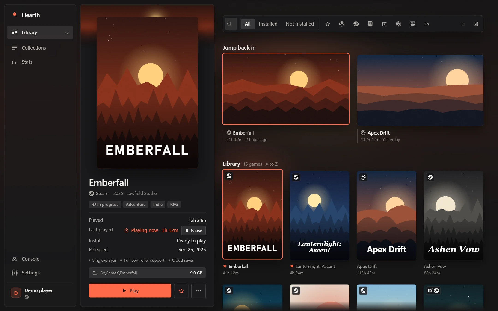
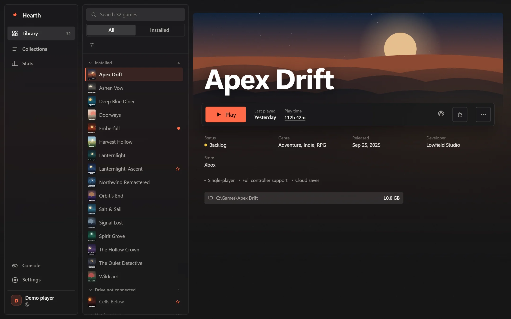
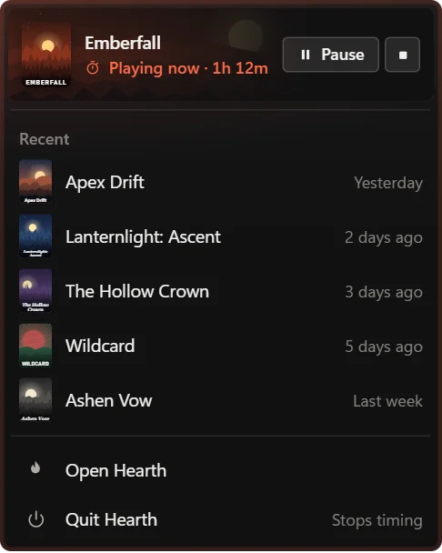

<p align="center">
  
</p>

<h1 align="center">Hearth</h1>

<p align="center">
  Every game you own, in one place: <b>Steam</b>, <b>Epic</b>, <b>Xbox / Game Pass</b>, <b>GOG</b> and any folder.<br>
  A fast, simple game library for Windows, with your real playtime. Written in Rust + Tauri.
</p>

<p align="center">
  <a href="https://github.com/koubayashi/Hearth/releases/latest"></a>
  <a href="https://github.com/koubayashi/Hearth/releases"></a>
  
  <a href="LICENSE"></a>
  
</p>

<p align="center">
  <a href="#get-started">Get started</a> ·
  <a href="#what-it-does">Features</a> ·
  <a href="#console-mode-for-the-couch">Console mode</a> ·
  <a href="#your-data-stays-on-your-pc">Privacy</a> ·
  <a href="#build-it-yourself">Build it</a>
</p>

Hearth gathers your games from every store into one library, starts each one through its own store, and sits in the tray timing what you play, however you launch it. No accounts, no themes to break, no clutter: big art, quick search, and a full-screen Console mode for the controller.

<picture>
  <source media="(prefers-color-scheme: light)" srcset="docs/screenshots/library-light.webp">
  
</picture>

<p align="center"><sub>The games in these screenshots are invented, drawn for Hearth's demo library.</sub></p>

## Get started

1. **Download** `Hearth_<version>_x64-setup.exe` from the [latest release](https://github.com/koubayashi/Hearth/releases/latest) and run it. It installs for your Windows account only: no admin rights.
2. **Sign in to your stores** in **Settings › Stores**: Steam, Epic, Xbox and GOG, each on its own sign-in page. Games installed on this PC show up even before you sign in.
3. **Play.** Pick a game and press **Play**, or start it any way you like. Hearth keeps timing from the tray after you close its window.

Hearth needs Windows 10 or 11 (64-bit) and Microsoft WebView2, which already ships with Windows 11.

**Microsoft SmartScreen warning.** The installer isn't code-signed (a certificate costs money every year), so Windows may show *"Windows protected your PC"* the first time. Click **More info** → **Run anyway**. Or build it yourself from source (below).

**Updates install themselves.** Hearth checks GitHub twice a day and downloads a new version quietly. A dot on Settings says when it's ready, and it restarts only when you say so, never in the middle of a game.

## What it does

### One library

- **Every store together.** Sign in to Steam, Epic, Xbox and GOG through each store's own page. Installed and not-yet-installed games appear side by side; **Install** hands off to the game's store.
- **Games from anywhere.** Add a folder (`D:\Games`) and the games in it show up too, with their own art.
- **Duplicates become one.** Own a game on two stores? It's one tile, and you choose which copy starts.
- **Versions of one game.** Combine GTA V and GTA V Enhanced, or a game and its remaster, into one entry with all their time. Separate them again any time.
- **Hide what you'll never play.** Unwanted freebies stay hidden, even after a sync.

### Your real playtime

- **Timed however you start a game:** from Hearth, the store, a desktop shortcut or the game's folder. Store totals (Steam, Epic, Xbox, GOG) are merged in without counting anything twice.
- **Idle time kept apart.** A game left open while you're away isn't counted as play. Its panel shows the split, as in "38h active · 2h idle". Prefer the stores' way? Count it all as play, for every game or just one.
- **Pause** a game's timing from the tray or its panel. It picks up again as soon as you're back.
- **Play history** for each game, and **Stats**: hours per week, most played, longest sessions.

<p align="center">
  
</p>

### Organised your way

- **Collections**, plus shelves that fill themselves: Favourites, In progress, Backlog, Completed, and browse by series, developer or publisher.
- **Sort and filter** by store, genre, install state, size, last played or most played. Search starts as you type.
- **Two layouts:** a cover wall, or a list beside a detail page with the game's art.
- **Artwork** from the stores and, with a free key, SteamGridDB. Pick a different cover for any game.
- **Ways to play:** start a game through a mod loader, an offline server or a tool, with its own arguments.
- **Storage:** what each installed game takes on disk, and uninstalling through its store (or to the Recycle Bin for folder games).

<p align="center">
  
</p>

### Console mode, for the couch

Press **Start** on a controller, from anywhere in Hearth, and it becomes a full-screen view made for the TV: big covers, shelves you move between with the D-pad, Play on **A**. Stats and settings are there too. Press **Start** again to go back to the desktop.

The whole app works with a controller, the keyboard or the mouse.

<p align="center">
  
</p>

### Part of Windows

- **Lives in the tray.** Close the window and Hearth keeps timing. Right-click the tray icon for what's playing now (with Pause and Stop), your recent games, and Open or Quit.
- **Taskbar jump list.** Right-click Hearth on the taskbar to start one of your last five games, or open Console mode.
- **Starts with Windows** if you want, straight to the tray.
- **Looks like Windows 11:** Mica, Snap Layouts, light or dark (or follow Windows), and seven tones with your own highlight colour.
- **Backups** of your library, playtime and settings, by hand or automatically to a folder you choose.

<p align="center">
  
  &nbsp;&nbsp;
  
</p>

## Your data stays on your PC

- Your library, playtime and settings live in `%APPDATA%\dev.hearth.app` and are never uploaded. There's no Hearth account and no telemetry.
- To fill in details, Hearth looks games up by name on public services: Steam's store, Wikidata (series and studios), PCGamingWiki (where saves live) and, if you add a key, SteamGridDB (art).
- Hearth never sees your store passwords. You sign in on each store's own page, and the sign-ins are kept in Windows Credential Manager.
- Hearth never downloads games. Installing and updating go through each game's store.

## Good to know

- **EA app and Ubisoft Connect** aren't read yet. Add their install folders under **Settings › Game folders** to see and time those games.
- **F5** refreshes the library. Coming back to Hearth's window also picks up games installed or removed since.
- Hearth is built and used by one person, on their own PC, and it's young. If something looks wrong, [open an issue](https://github.com/koubayashi/Hearth/issues).

## Build it yourself

You need Windows 10 or 11, Rust (stable, MSVC toolchain), Node 24 and WebView2.

```bash
cd app
npm ci
npm run tauri dev      # the app, with the interface reloading as you edit
npm run dev            # the interface alone in a browser, on a demo library
```

Tests, from the repo root (build the interface first, since the app embeds it):

```bash
cd app && npm run build && npm test && cd ..
cargo test --workspace
```

```
crates/
  hub-core       data model, SQLite database, playtime merging
  hub-providers  store integrations, artwork, save files
  hub-launch     launching games and store installers
  hub-tracker    playtime tracking from running processes
app/             React + TypeScript + Vite interface
app/src-tauri/   the Tauri 2 shell: commands, tray, sync, updates
```

Read [CONTRIBUTING.md](CONTRIBUTING.md) before changing anything. It covers conventions and what never to commit, for people and AI coding agents alike.

## License

GPL-3.0-or-later
